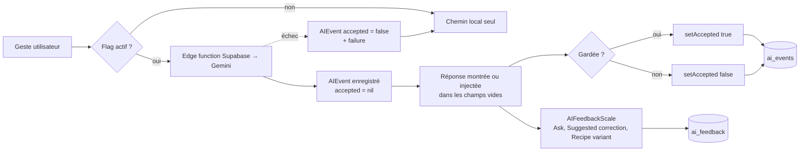

# Boucle d’apprentissage et de feedback IA — Kohi

**Date** : 8 novembre 2026 · **État** : build 13 (code local, fonction `card-vision` modifiée mais pas encore déployée).

Ce document décrit comment Kohi mesure l’utilité de chaque appel à un modèle : ce qui est enregistré, quand on considère qu’une réponse a été « gardée », où l’utilisateur peut noter une réponse, et ce qui manque encore. Rien n’apprend automatiquement dans l’app : aucun modèle n’est ré-entraîné ni ajusté à partir de ces données. La boucle sert à **décider**, feature par feature, ce qui mérite de survivre à l’expérimentation, et avec quel modèle.

---

## 1. Vue d’ensemble

Deux signaux, indépendants, alimentent deux tables Supabase :

| Signal | Origine | Table | Qui le produit |
|---|---|---|---|
| `accepted` (oui / non / pas de réponse) | implicite, déduit du geste | `ai_events` | le code, à la sauvegarde ou au choix |
| score de 1 à 4 + commentaire | explicite, demandé | `ai_feedback` | l’utilisateur, sous certaines réponses |

Le principe constant : **le modèle ne remplace jamais le chemin local**. Il ne remplit que des champs vides, ou propose une option sous la proposition par règles. Si l’appel échoue, l’app se comporte comme si la feature était coupée.

---

## 2. Les features et leurs edge functions

Source : [`AIFeature`](../Kohi/AI/AIFeature.swift).

| Feature (`rawValue`) | Edge function | Rôle | Expérimentale |
|---|---|---|---|
| `card-vision` | `card-vision` | Lire un paquet, un reçu ou une étiquette d’eau que l’OCR local a mal lu | non |
| `menu-extract` | `field-extract` | Lire un menu de café photographié, à partir du texte OCR seulement | non (depuis build 13) |
| `field-extract` | `field-extract` | Comprendre une dictée (brew, étiquette, nettoyage de transcript) | oui |
| `recipe-adapt` | `recipe-adapt` | Proposer une variante sous la recette par règles | oui |
| `ask` | `ask` | Répondre depuis la base de connaissances vérifiée, avec citations | oui |
| `suggested-correction` | `suggested-correction` | Classer trois ajustements parmi l’ensemble admissible calculé localement | oui |
| `ai-feedback` | — | Affichage de l’échelle d’utilité | non |

Toutes les edge functions appellent Gemini, modèle par défaut `gemini-3.6-flash`, surchargeable par la variable d’environnement `GEMINI_MODEL` côté Supabase (`ask` a aussi `GEMINI_MODEL_FALLBACK`, par défaut `gemini-2.5-flash`). Températures basses (0 à 0,2) et `thinkingLevel: "low"`. Chaque fonction renvoie au client le **modèle réellement utilisé**, les tokens et la latence, pour que la ligne `ai_events` reflète le vrai coût. Il n’y a pas de sélecteur de modèle dans l’app : changer de modèle se fait côté serveur, et les données se comparent par la colonne `model`.

---

## 3. Qui a le droit d’appeler un modèle : `AIFlags`

Source : [`AIFlags`](../Kohi/AI/AIFlags.swift). Une seule question pour le reste de l’app : `flags.isOn(feature)`. Une feature est active si les trois conditions sont réunies :

1. **Interrupteur « Experimental AI »** (`isExperimentalEnabled`, dans Profil) : ne concerne que les features `isExperimental`. `card-vision`, `menu-extract` et `ai-feedback` y échappent : ce sont des fonctions de base, pas des essais.
2. **Refus par l’utilisateur** (`disabledByYou`) : chaque feature a son interrupteur dans Profil, avec la phrase `fallback` qui dit ce qu’on perd (« Labels are read on device only. »).
3. **Coupure serveur** (`disabledByServer`) : table `ai_flags`, lisible par tout compte connecté, modifiable seulement depuis le dashboard ou un service role. Rechargée au lancement et après une synchro. Une ligne absente vaut « activée » ; un échec de chargement garde le dernier état connu. Dans Profil, la raison s’affiche : « Experimental AI is off », « Paused » ou « Off ».

---

## 4. La télémétrie : `AIEvent` et `AIEventLog`

Source : [`AIEvent.swift`](../Kohi/AI/AIEvent.swift), migration [`0012_ai.sql`](../supabase/migrations/0012_ai.sql).

Un `AIEvent` = un appel à un modèle :

| Champ | Sens |
|---|---|
| `id` | UUID, clé de l’upsert |
| `feature` | la feature ci-dessus |
| `model` | le modèle renvoyé par le serveur (`"unknown"` en cas d’échec réseau) |
| `inputTokens`, `outputTokens` | coût, quand le serveur les renvoie |
| `latencyMs` | aller-retour ; celui du serveur s’il est fourni, sinon mesuré par l’app |
| `accepted` | `nil` tant que personne n’a répondu, puis `true` ou `false` |
| `failure` | message d’erreur ; un échec est toujours enregistré avec `accepted = false` |

`AIEventLog` :

- `record(_:)` ajoute l’événement à la file et à `recent` (les 20 derniers, en mémoire), puis tente un envoi.
- `setAccepted(_:for:)` donne le verdict plus tard. Si l’événement est déjà parti, il est renvoyé avec le même `id` : l’**upsert** sur `ai_events` écrase la ligne.
- L’envoi est un upsert par lots dans `ai_events`. **Un lot qui échoue est jeté**, pas réessayé : la télémétrie n’entre volontairement pas dans l’outbox des données utilisateur. File plafonnée à 200.
- `acceptanceLine` affiche dans Profil « *n* of *m* kept » dès qu’au moins trois événements récents ont un verdict. C’est un indicateur à surveiller, pas une métrique à optimiser.
- RLS : chaque utilisateur ne voit que ses propres lignes.

---

## 5. Ce que veut dire « accepted », feature par feature

C’est le cœur de la boucle : le coût se mesure facilement, mais savoir si la réponse a été gardée demande une définition par feature.

### 5.1 Lecture par vision (`card-vision`) : le `ModelFill`

Source : [`ScanPipeline.swift`](../Kohi/Process/ScanPipeline.swift).

Le modèle n’est appelé que si la lecture locale est faible (`wantsVisionAssist`) ou vide. Ses valeurs ne vont que dans les champs vides (`fillMissing`). Au moment de l’injection, on mémorise un `ModelFill` : l’`eventID` et, champ par champ, **les valeurs du modèle qui ont réellement atterri** dans un emplacement vide (`ModelFill.landed`). Les champs sont comparés sous forme de texte normalisé (`FieldValues`) avec les mêmes clés pour une lecture, une fiche café et un café dégusté.

À la sauvegarde :

- `accepted = true` si **au moins une** de ces valeurs est toujours là, inchangée ;
- `accepted = false` si toutes ont été modifiées ou effacées, si le brouillon est abandonné, ou si l’appel n’a rien rempli (un aller-retour pour aucun champ compte comme non gardé).
- `accepted = false` immédiatement si le modèle répond que la photo n’est pas une étiquette de café.

Deux points d’entrée :

- **Collection** (`ScanPipeline.fields`) : codes-barres, lien produit, puis vision si besoin. Le verdict est rendu par `CardEditSheet.answerModelFills(saved:)` à l’enregistrement, ou à la fermeture sans enregistrer. Le rescan depuis la fiche enregistre aussi son événement.
- **Dégustation** (`ScanPipeline.secondOpinion`) : vision seule sur la photo en mémoire, sans codes-barres ni lien. Le `ModelFill` est d’abord restreint à ce qui a atteint le brouillon (`narrowed`), puis `TastingReader.answerModels(saved:)` rend le verdict à la sauvegarde ou à l’abandon.

### 5.2 Lecture de menu (`menu-extract`)

Source : `TastingReader` dans [`TastingFields.swift`](../Kohi/Tastings/TastingFields.swift).

Quand la photo est reconnue comme un menu, l’app montre immédiatement la liste lue localement et demande en parallèle au modèle (spinner dans la feuille). Les cafés renvoyés sont filtrés pour ne garder que ce qui figure vraiment dans le texte OCR (`MenuParser.grounded`).

- L’utilisateur choisit un café dans la liste du modèle : `true`.
- Il ferme la feuille sans choisir : `false`.
- Il a déjà choisi dans la liste locale avant la réponse, ou le modèle n’a rien renvoyé d’ancré dans le texte : `false`.

### 5.3 Variante de recette (`recipe-adapt`)

Source : [`RecipeDetailSheet`](../Kohi/Recipes/RecipeDetailSheet.swift).

- « Use the variant » : `true`. « Dismiss » : `false`.
- Une réponse « rien à changer » est enregistrée sans verdict : on veut voir dans les données un modèle qui trouve toujours quelque chose à dire.

### 5.4 Dictée de brew (`field-extract`)

- **Nettoyage du transcript** après un brew narré (`FieldExtract.tidy`) : l’événement est enregistré, mais **aucun verdict n’est rendu**, qui reste `nil`.
- **Extraction de champs** (`FieldExtract.brew`, `FieldExtract.label`) : le câblage du verdict existe (`BrewPrefill.finish` passe `true` à la sauvegarde si `dictationEventID` est présent), mais ces deux fonctions n’ont **aucun appelant** dans l’app aujourd’hui et `dictationEventID` n’est jamais renseigné. Ce chemin est dormant.

### 5.5 Ask et Suggested correction

Aucun `setAccepted` : ces réponses se lisent, elles ne s’appliquent pas à un champ. Leur événement reste `accepted = nil` (sauf échec). Leur utilité est mesurée **uniquement par l’échelle explicite** (section 6).

### Récapitulatif

| Feature | `true` | `false` | reste `nil` |
|---|---|---|---|
| card-vision | une valeur du modèle survit à la sauvegarde | tout modifié ou effacé, abandon, rien rempli | — |
| menu-extract | choix dans la liste du modèle | fermeture, choix local avant la réponse, rien d’ancré | — |
| recipe-adapt | « Use the variant » | « Dismiss » | réponse « rien à changer » |
| field-extract (tidy) | — | échec | toujours |
| field-extract (brew, label) | prévu à la sauvegarde du brew | échec | dormant, aucun appelant |
| ask | — | échec | toujours, voir l’échelle |
| suggested-correction | — | échec, JSON invalide | toujours, voir l’échelle |

---

## 6. Le feedback explicite : `AIFeedbackScale`

Sources : [`AIFeedback.swift`](../Kohi/AI/AIFeedback.swift), [`AIFeedbackStore.swift`](../Kohi/AI/AIFeedbackStore.swift), [`AIFeedbackScale.swift`](../Kohi/AI/AIFeedbackScale.swift), migration [`0018_ai_feedback.sql`](../supabase/migrations/0018_ai_feedback.sql).

- Question « How useful was this? », quatre niveaux : *Not at all* (1), *A little* (2), *Useful* (3), *A lot* (4), plus un commentaire libre.
- Affichée sous trois sorties seulement, quand le flag `ai-feedback` est actif :
  - la réponse d’**Ask** ([`AskSheet`](../Kohi/AI/AskSheet.swift)) ;
  - la **Suggested correction** ([`BrewReadView`](../Kohi/Recipes/BrewReadView.swift)) ;
  - la **variante de recette** ([`RecipeDetailSheet`](../Kohi/Recipes/RecipeDetailSheet.swift)).
- **Pas d’échelle sous les lectures de scan ni de menu, par décision** : le geste (garder ou corriger les champs) est déjà le signal, et demander une note après chaque scan alourdirait la saisie.
- Chaque note est liée à son `ai_event_id`. Noter à nouveau la même réponse remplace la note précédente au lieu d’en ajouter une.
- Stockage local dans `ai-feedback.json`, poussé par upsert dans `ai_feedback` quand on est connecté (RLS privée), exportable en CSV depuis le compte (`kohi-ai-feedback.csv`).

Les deux tables se croisent par `ai_feedback.ai_event_id = ai_events.id` : on peut lire, pour une même réponse, le modèle, le coût, la latence et la note.

---

## 7. Le cache de session : `AICallCache`

Source : [`AICallCache.swift`](../Kohi/AI/AICallCache.swift).

En mémoire seulement, vidé au redémarrage (ou par `reset()`). Il couvre les appels déclenchés par l’ouverture d’une feuille, pour ne pas payer un nouvel appel à chaque réouverture :

- Suggested correction, par clé brew + commentaire + ensemble admissible (contournable par `refresh`) ;
- variante de recette, y compris la réponse « pas de variante » ;
- transcript nettoyé.

Ask, la vision et la lecture de menu ne sont pas mis en cache : ce sont des gestes explicites avec une entrée nouvelle à chaque fois. Un résultat servi par le cache **ne crée pas de nouvel `AIEvent`** : le verdict porte sur l’événement d’origine.

---

## 8. Lire les données

Questions que les deux tables permettent de trancher :

- **Taux de garde par feature et par modèle** : `ai_events` groupé par `feature, model` sur `accepted is not null`.
- **Coût d’une réponse gardée** : tokens et latence des lignes `accepted = true` rapportés au total.
- **Taux d’échec** : `failure is not null`, par modèle.
- **Écart entre geste et note** pour Ask, Suggested correction et variante : jointure `ai_feedback` ↔ `ai_events`.
- **Features que personne n’utilise** : beaucoup de `nil` sur une feature à verdict (vision, menu, variante) veut dire des brouillons jamais clos ou un câblage manquant.

---

## 9. Écarts connus et prochaines étapes

1. **Déployer `card-vision`** : la version locale renvoie `model`, tokens et latence ; tant qu’elle n’est pas déployée, les événements vision portent `model = "unknown"`, pas de tokens, et une latence mesurée par l’app.
2. **Mesurer sur une dizaine de scans réels** (collection et dégustation) avant de juger le taux de garde de la vision et du menu.
3. **Extraction de dictée dormante** : `FieldExtract.brew` et `FieldExtract.label` ne sont appelées nulle part. Les rebrancher ou les retirer est une décision produit, pas prise ici.
4. **Nettoyage de transcript sans verdict** : il faudrait définir ce que « gardé » veut dire (par exemple, la note n’a pas été modifiée avant la sauvegarde). Décision à prendre.
5. **Code inutilisé laissé en place** : `TastingReader.askModel` (ancien bouton « demander au modèle » du menu) et `CupPrice.localCurrency`.
6. **`card-poster`** a une ligne dans `ai_flags` mais n’existe plus comme feature côté app (voir [`ai-poster-retired.md`](ai-poster-retired.md)) ; la ligne est ignorée.
