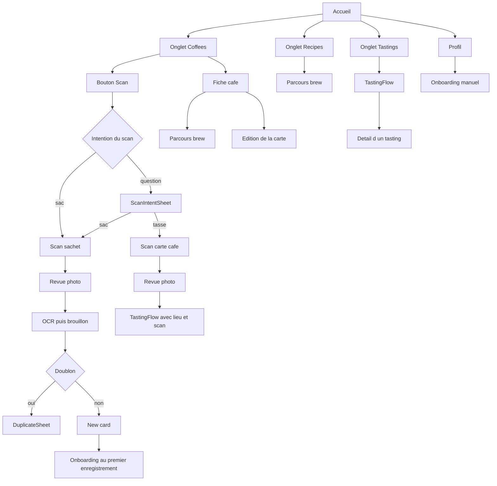

# Diagnostic UX — Kohi

**Date** : 7 novembre 2026 · **Périmètre** : lecture du code, aucune modification de l’app.

Ce document cartographie les flux et les champs de dictée pour cadrer les décisions UX. La colonne **Décision** de l’inventaire vocal est vide : rien n’est retiré ici.

Quatre corrections sont déjà confirmées et restent à appliquer dans une phase suivante (saisie clavier des steppers, sélecteur de devise unique, spider graph en temps réel, saveurs de la roue cliquables). Elles sont rappelées en section 4 pour que le constat soit complet. Trois sujets restent ouverts et ne reçoivent aucune recommandation (section 5).

---

## 1. Carte des flux

L’accueil est [`GridScreen`](../Kohi/Grid/GridScreen.swift) : trois onglets (Coffees, Recipes, Tastings) et le Profil en feuille. Presque tous les parcours longs s’ouvrent en plein écran. La fiche café est le seul écran poussé dans la pile de navigation.

### 1.1 Scan tasting

Ajouter un tasting, une question par écran. Hôte : [`TastingFlow`](../Kohi/Tastings/TastingFlow.swift), présenté en `fullScreenCover`.

**Entrées**

| Entrée | Où |
| --- | --- |
| Onglet Tastings, bouton + | `GridScreen`, si la liste n’est pas vide |
| État vide de Tastings | `TastingsScreen.onAdd` |
| État vide de Coffees | bascule vers Tastings puis ouvre le flux |
| Scan « tasse » depuis l’accueil | `ScanIntentSheet` → caméra → `TastingFlow(place:scan:)` |
| Rescan dans le flux | `ScanScreen` imbriqué, lui aussi en plein écran |

**Étapes** (`TastingStep`) : lieu → source → café → préparation → note → souvenir.

Le lieu disparaît si le scan tasse l’a déjà fourni. Un scan préalable ouvre le flux directement sur « Which coffee? ».

| Étape | Question | Contenu | Actions du pied |
| --- | --- | --- | --- |
| `place` | Where are you? | suggestion proche, ou choix via `WhereSheet` / `PlaceSearchView` | Suivant (actif seulement si un lieu est choisi). Pas de retour : c’est la première étape. |
| `source` | What's in the cup? | scanner la carte, prendre dans la collection (`RecipeCoffeePicker`), ou taper | Pas de Suivant : chaque rangée avance. |
| `coffee` | Which coffee? | champs d’identité, lecture OCR, dictée du nom | Suivant (nom requis). « Rescan » si l’on vient d’un scan. |
| `made` | How was it made? | méthode, prix, photos. Pas de date. | Skip, Save now (si le brouillon est enregistrable), Suivant |
| `rating` | How was it? | note, saveurs | Skip, Save now, Suivant |
| `remember` | Anything to remember? | spider graph, sliders, note | Save (capsule noire) |

Chrome commun : [`StepFlow`](../Kohi/Design/StepFlow.swift). Chevron retour, filets de progression, croix qui demande confirmation avant d’abandonner. Feuilles imbriquées : lieu, recherche de lieu, collection, choix OCR du menu (`MenuPickSheet`).

L’édition d’un tasting déjà enregistré n’emprunte pas ce flux. Elle ouvre [`TastingComposeSheet`](../Kohi/Tastings/TastingComposeSheet.swift), une feuille unique avec Cancel et Save dans la barre. Cette feuille affiche la date ; l’étape « How was it made? » du flux, non.

Le détail d’un tasting (`TastingDetailView`) est poussé depuis l’onglet Tastings ou depuis la fiche café.

### 1.2 Scan collection

Ajouter une carte à l’archive. Orchestré par [`RootView`](../Kohi/App/RootView.swift).

**Entrée** : bouton Scan de l’onglet Coffees. [`ScanIntent.decide`](../Kohi/Process/ScanIntent.swift) envoie soit directement au sac, soit vers `ScanIntentSheet` (sac ou tasse) quand un café proche est plausible.

**Enchaînement**

1. `ScanScreen` en plein écran. Capture VisionKit, caméra, ou simulation en debug. Cancel ferme.
2. `ScanReviewScreen`. Retake en haut à gauche, Whiten, Use en capsule sur fond sombre.
3. Ingestion OCR en arrière-plan (indicateur sur l’accueil).
4. Si le café est déjà dans l’archive : feuille `DuplicateSheet`. Sinon : feuille `CardEditSheet` titrée « New card ».
5. Au premier enregistrement réussi, `SetupFlowController` présente l’onboarding après un court délai.

**DuplicateSheet.** Trois réponses, aucun bouton Fermer dans la barre : ouvrir la carte existante, « this is a different coffee » (conserve le scan), ajouter la photo à la carte existante. Balayer la feuille pour la fermer jette le scan : les fichiers de l’image sont supprimés dans `discardAbandonedDuplicate`.

**New card.** Save est dans la barre, à droite. Il n’y a pas de Cancel. « Discard this scan » est un libellé en bas du défilement. L’édition d’une carte déjà archivée réutilise la même feuille, titrée « Edit », avec « Remove from archive » au même endroit.

### 1.3 Brews

Un seul hôte, [`BrewFlowHost`](../Kohi/Recipes/BrewFlowHost.swift), en `fullScreenCover`. Toutes les entrées mutent un `BrewSession`.

**Entrées**

| Entrée | Départ |
| --- | --- |
| Fiche café, onglet Brews | souvent le lanceur si le café a déjà une tasse, sinon la recette |
| Onglet Recipes, bouton tasse | choix du café (`RecipeCoffeePicker`), puis le parcours |
| Reprise | alerte au lancement si un `BrewDraft` existe ; notification `BrewDraft.resumeNotification` |
| Raccourci / Siri | `IntentRouter`, log ou start a brew |
| « Brew again » | reprend au cadran (dose, eau) |

**Étapes** (`BrewSession.Step`) : start → previous ou scope ou kit → dial → pour → after → read.

Le lanceur (start) n’apparaît que si le café a déjà une tasse et qu’aucune recette n’a été imposée. Le premier brew d’une carte saute cette étape. « Already brewed » sur le cadran saute le minuteur et va à After. L’édition d’un brew passé ouvre After directement.

| Étape | Vue | Fermer | Avancer |
| --- | --- | --- | --- |
| start | `BrewStartView` | croix, et le retour quitte aussi | choix : répéter, précédent, recette, from scratch |
| previous | `BrewPreviousView` | croix | choix d’un brew passé |
| scope | `BrewScopeView` | croix | Suivant vers le cadran |
| kit | `BrewKitView` | croix | Suivant vers le cadran |
| dial | `BrewDialView` | croix | glisser pour lancer le minuteur, ou « already brewed » |
| pour | `GuidedBrewView` | annuler revient au cadran | fin du minuteur |
| after | `AfterBrewSheet` | pas de croix | Save |
| read | `BrewReadView` | — | Done ferme le parcours |

La progression est dynamique (`progressTotal`) : le choix du café, le lanceur et le minuteur comptent ou non selon l’entrée. Fermer avant After enregistre un brouillon et l’accueil proposera de le reprendre. Save efface le brouillon et enchaîne sur Read.

After ouvre en feuilles la comparaison et l’éditeur d’étapes. Le commentaire du brew et l’évaluation sensorielle (note, sliders, saveurs) sont sur After, pas sur un écran séparé.

### 1.4 Fiche d’un café

Poussée depuis une tuile de la grille : [`CardDetailView`](../Kohi/Detail/CardDetailView.swift). La barre système est masquée ; le retour est `CatalogueBackButton` (« Coffees »).

Deux onglets, rail épinglé : Coffee et Brews (avec le nombre de tasses).

**Coffee**, dans l’ordre quand le bloc a du contenu : notes du torréfacteur, « On the wheel », légende, champs d’origine, recettes, invite à remplir le kit, pièces jointes, note perso, puis Edit / Symbol / Remove.

**Brews** : profil agrégé à partir de deux brews, journal ou état vide, tastings liés au café (« tasted at »).

**Présentations ouvertes depuis la fiche**

| Présentation | Contenu |
| --- | --- |
| feuille | Profil, Ask, édition de la carte, détail de recette, matériel, comparaison de brews, pièce jointe |
| plein écran | parcours brew, scan d’une pièce jointe, éditeur de symbole |
| poussée | détail d’un tasting |

Les notes et « On the wheel » sont des pastilles de texte. Un appui ne change rien. Les saveurs goûtées par l’utilisateur vivent sur le brew (`Brew.flavors`) et sur le tasting (`Tasting.flavors`), pas sur la carte.

### 1.5 Profil

Feuille [`ProfileSheet`](../Kohi/Setup/ProfileSheet.swift), depuis l’icône personne de l’accueil, et aussi depuis Recipes, le détail d’une recette et la fiche café.

Défilement unique : kit, filtres, eau, défauts, affichage, convertisseur de mouture, « Set up again », section développeur, import / export, drapeaux, IA expérimentale, compte. Done dans la barre ferme la feuille.

Chaque éditeur (matériel, eau, filtre, convertisseur, compte, onboarding) est une feuille posée sur le Profil.

### 1.6 Onboarding

Feuille [`SetupFlowSheet`](../Kohi/Setup/SetupFlowSheet.swift).

**Entrées** : automatiquement après le premier scan de collection enregistré (`SetupFlowController.noteFirstScanSaved`, une seule fois) ; manuellement via « Set up again » dans le Profil. Si le kit est déjà rempli, l’ouverture manuelle saute l’intro et commence à « How do you brew? ».

| Étape | Chrome | Avancer |
| --- | --- | --- |
| entry, « Bring what you have » | en-tête et pied dessinés à part, pas `StepFlow` | « Set up by hand ». Skip ferme tout le parcours. Import et photo du kit sont affichés, marqués « soon », et ne répondent pas au toucher. |
| brew, « How do you brew? » | `StepFlow`, question 1 sur 3 | Skip, Suivant, croix |
| grind, « What do you grind with? » | `StepFlow`, 2 sur 3 | Skip, Suivant, croix |
| water, « What water? » | `StepFlow`, 3 sur 3 | Skip, Done, croix |

La croix et le Skip de l’intro appellent `dismissed()` : l’onboarding ne se représentera pas tout seul.

---

## 2. Incohérences d’ergonomie

Constat seulement. Les quatre lignes déjà tranchées sont reprises en section 4.

### Chrome et sortie

| Sujet | Ce que l’app fait aujourd’hui |
| --- | --- |
| Enregistrer | Capsule noire « Save » dans `StepFlow` (fin du tasting, fin du brew). Bouton « Save » de la barre, poids medium, sur New card, Edit et `TastingComposeSheet`. « Done » sur le Profil et sur la dernière question de l’onboarding. |
| Fermer | Croix + chevron dans `StepFlow`. `CatalogueBackButton` sur la fiche. Cancel dans la barre du seul `TastingComposeSheet`. Cancel / Retake sur le fond sombre du scan. |
| New card | Pas de Cancel dans la barre. Abandonner le scan demande de descendre jusqu’à « Discard this scan ». |
| Doublon | Pas de bouton Fermer. Balayer la feuille supprime le scan. |
| Fin de brew | After n’a pas de croix (`onClose: nil`). Les étapes d’avant en ont une, et cette croix pose un brouillon reprenable. After a un retour vers le cadran. |
| Skip | Pied de `StepFlow` (Skip à gauche, rond Suivant à droite). L’intro de l’onboarding a son propre Skip, qui ferme le parcours entier, et pas de rond Suivant. |
| Progression | Filets 24 × 1 pt, un par étape, dans `StepFlow`. Le brew recalcule le nombre de filets selon l’entrée. L’intro de l’onboarding n’affiche pas de filets. |
| Où vit l’écran | Plein écran pour tasting, scan, brew. Feuille pour new card, doublon, profil, onboarding, édition. Poussée pour la fiche café et le détail d’un tasting. |

### Saisie des mêmes données

| Donnée | Carte (collection) | Tasting | Brew |
| --- | --- | --- | --- |
| Prix | `RollingCounter`, pas de 1, de 0 à 999. La devise est l’unité affichée à côté du nombre. | Champ texte « 0,00 », pavé décimal. | — |
| Devise | Quatre chips : EUR, USD, GBP, JPY. Retaper la chip active la retire (`nil`). Liste locale à [`CardEditSheet`](../Kohi/Edit/CardEditSheet.swift). | Menu de dix codes : EUR, USD, GBP, JPY, CHF, AUD, CAD, SEK, DKK, NOK (`CupPrice.commonCurrencies`). Toujours un code, jamais vide. | — |
| Devise par défaut | Rien, sauf si l’OCR en a lu une. `CoffeeCard.currency` est optionnel. | `CupPrice.localCurrency` (devise de la région, sinon EUR) à l’ouverture d’un flux neuf. Le brouillon construit ailleurs part sur `"EUR"`. | — |
| Date | `DatePicker` « Roasted on ». | Absente de l’étape « How was it made? ». Présente dans `TastingComposeSheet` (`showsDate: true`). | Présente sur After. |
| Saveurs annoncées | Pastilles « Notes » et « On the wheel », non tappables. | Proposées dans le bloc saveurs de l’étape note, et dans l’évaluation d’After. | Idem, écrites sur `Brew.flavors`. |
| Goût (0–10) | — | Spider + sliders sur « Anything to remember? ». Le chiffre et le graphe suivent la valeur au relâchement du doigt. | Même bloc sur After (`TasteBlock`). |

Le composant +/− est [`RollingCounter`](../Kohi/Design/RollingCounter.swift). Un appui sur le nombre est prévu pour ouvrir le clavier (le commentaire du type le dit), et le champ existe dans la vue. Il ne s’affiche pas : l’état qui le montre est le même focus que le champ devrait recevoir, donc le focus n’a rien à accrocher. L’appui long et le glissement vertical, eux, changent la valeur. Cela concerne le prix, l’Agtron, le poids du sachet, le score de cupping, et tous les autres compteurs (recette, cadran, After, matériel, eau, calibration).

### Deux modèles de voix

La dictée en direct ([`DictationField`](../Kohi/Design/DictationField.swift), micro « Dictate », reconnaissance locale) écrit dans un champ pendant la frappe. L’enregistrement de brew ([`NarrationPill`](../Kohi/Design/NarrationPill.swift) pendant le minuteur) garde un fichier audio et le transcrit après, sur After ou via l’alerte « Unfinished recording » au prochain lancement.

---

## 3. Inventaire de la dictée

Chaque ligne est un champ que l’utilisateur peut atteindre. **Décision** est à remplir : Garder ou Supprimer. Rien n’a été retiré.

Le mode `.replace` écrase le champ avec ce qui vient d’être dit. Le mode `.append` (défaut) ajoute à la fin.

### 3.1 Dictée en direct (`DictationField`)

| Écran | Champ | Usage | Mode | Fichier | Décision |
| --- | --- | --- | --- | --- | --- |
| Tasting, « Which coffee? » | Nom du café | Dire le nom pendant la saisie ou après un scan | replace | `Kohi/Tastings/TastingFlow.swift:331` | |
| Tasting, « Anything to remember? » | Note to self | Note libre du tasting | append | `Kohi/Tastings/TastingFlow.swift:403` | |
| Édition d’un tasting (`TastingComposeSheet`) | Note to self | Même note, sur la feuille d’édition | append | `Kohi/Tastings/TastingComposeSheet.swift:97` | |
| New card / Edit | Note to self | Note personnelle de la carte | append | `Kohi/Edit/CardEditSheet.swift:149` | |
| New card / Edit, via `TagField` | Nouvelle note de dégustation | Dicter un tag avant de le valider. Seul appelant : les tasting notes de la carte (`CardEditSheet.swift:106`) | append | `Kohi/Edit/TagField.swift:111` | |
| Fiche torréfacteur (`RoasterSheet`) | Nom | Nom du torréfacteur | append | `Kohi/Edit/RoasterSheet.swift:46` | |
| Ask | Question | Question posée à l’IA | append | `Kohi/AI/AskSheet.swift:66` | |
| Retour sur une réponse IA (`AIFeedbackScale`) | Commentaire | « What would have helped? », visible une fois la note choisie | append | `Kohi/AI/AIFeedbackScale.swift:51` | |
| After brew | Comment | Commentaire de la tasse | append | `Kohi/Recipes/AfterBrewSheet.swift:318` | |
| Édition de recette (`RecipeEditSheet`) | Name | Nom de la recette | append | `Kohi/Recipes/RecipeEditSheet.swift:40` | |
| Constructeur d’étapes (`StepBuilderSheet`) | Name | Nom de la recette en cours de construction | append | `Kohi/Recipes/StepBuilderSheet.swift:62` | |
| Matériel (`EquipmentSheet`) | Notes | Note libre sur un équipement | append | `Kohi/Setup/EquipmentSheet.swift:438` | |
| Eau (`WaterSheet`) | Notes | Note libre sur un profil d’eau | append | `Kohi/Setup/WaterSheet.swift:315` | |
| Calibration du moulin (`GrindConverterSheet`) | Note | D’où vient le réglage | append | `Kohi/Setup/GrindConverterSheet.swift:316` | |

Quatorze champs, douze fichiers. `TastingFlow` en porte deux.

### 3.2 Enregistrement pendant le brew

Ce n’est pas un `DictationField`. Le minuteur n’a pas de dictée en direct : le test `DictationFieldInventoryTests` le verrouille (`GuidedBrewView` contient `NarrationPill` et pas `DictationField`).

| Écran | Contrôle | Usage | Fichier | Décision |
| --- | --- | --- | --- | --- |
| Minuteur (`GuidedBrewView`) | `NarrationPill` | Enregistrer pendant le versement. Le fichier est porté par `BrewVoiceNote`. | `Kohi/Recipes/GuidedBrewView.swift:489` | |
| After brew | transcription automatique | `transcribeVoiceNoteIfNeeded` passe le texte au commentaire et à `SpokenBrewParser` (eau, filtre, etc.). | `Kohi/Recipes/AfterBrewSheet.swift` | |
| Accueil, au lancement suivant | alerte « Unfinished recording » | Si l’enregistrement n’a pas été transcrit : Transcribe l’ajoute aux notes du brew, Discard le jette. | `Kohi/App/RootView.swift:179` | |
| (pas d’écran) | `VoiceNoteTranscriber` | Reconnaissance sur le fichier, locale, plusieurs passes. | `Kohi/Scan/VoiceNoteTranscriber.swift` | |

La ligne After et la ligne alerte dépendent de la pilule du minuteur : les retirer n’a de sens que si l’enregistrement pendant le versement part aussi.

### 3.3 Verrou de test

`DictationFieldInventoryTests` (`KohiTests/DevBrief4Tests.swift`) exige un `DictationField` dans dix fichiers : CardEditSheet, AskSheet, AfterBrewSheet, StepBuilderSheet, RecipeEditSheet, RoasterSheet, TagField, GrindConverterSheet, EquipmentSheet, WaterSheet, AIFeedbackScale. Il ne cite ni `TastingFlow.swift` ni `TastingComposeSheet.swift`, qui en ont pourtant un. Une suppression ultérieure devra mettre cette liste à jour, et décider si les deux fichiers de tasting y entrent.

---

## 4. Constats déjà tranchés

Ces quatre points sont confirmés. Ils ne sont pas appliqués dans cette phase. Le comportement actuel :

1. **Steppers.** L’appui sur la valeur de `RollingCounter` ne fait pas apparaître le clavier. Les touches +/− restent.
2. **Devise.** Chips à quatre codes sur New card, menu à dix codes sur « How was it made? ». La cible confirmée est le composant à chips, une seule liste, présélection selon la région (modifiable).
3. **Spider graph.** Sur « Anything to remember? », `SloshRail` met à jour le binding dans `onEnded`. Le chiffre à droite du slider et `TasteRadar` bougent au relâchement. Le même bloc est sur After brew.
4. **Saveurs.** Sur la fiche, la rangée « On the wheel » (`CardDetailView.onTheWheel`) affiche `declaredFlavors`, calculé depuis les notes du torréfacteur. Les pastilles ne sont pas des boutons. La cible confirmée : les rendre cochables, enregistrer le choix sur la carte, et le synchroniser.

---

## 5. À cadrer — aucune décision

Description du comportement actuel, pour servir de base. Pas de recommandation.

**Précision du scan tasting et du scan collection.** Les deux passes utilisent la même caméra et la même revue (Retake / Use). Ensuite elles divergent. Le sac passe par l’ingestion de `RootView` (OCR, détection de doublon, feuille New card). La tasse remet l’image à `TastingFlow`, qui la lit sur l’étape café via `TastingReader` (barres « Reading the card », ou « Couldn’t read this »). Aucun écart de précision n’est mesuré ici.

**Relecture IA.** Sur l’étape café du tasting, `MenuPickSheet` peut proposer une lecture modèle si le drapeau `menuExtract` est allumé (`TastingFlow` appelle `reader.askModel`). Ce drapeau vit dans la section expérimentale du Profil. Le scan collection a son propre pipeline d’OCR, sans cette feuille.

**Moment du lieu.** Aujourd’hui le lieu est avant le scan dans un seul cas : le bouton Scan de l’accueil, quand `ScanIntent` pose la question sac ou tasse et qu’une suggestion de café est déjà là. Le flux tasting ouvert depuis l’onglet demande « Where are you? » en première étape, et la saute si le scan tasse a déjà nommé le lieu. Le scan collection ne demande pas de lieu avant la photo ; « bought at » est un champ de New card, après l’OCR.
